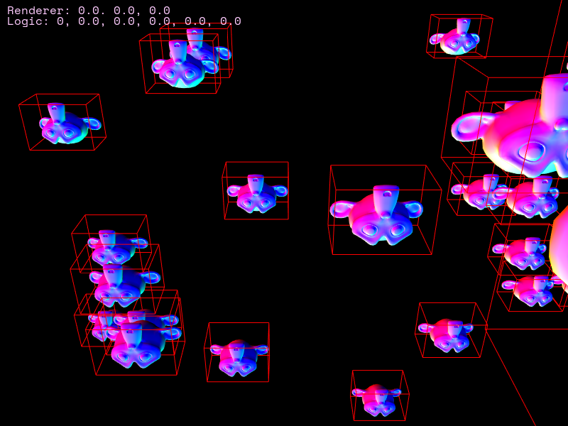
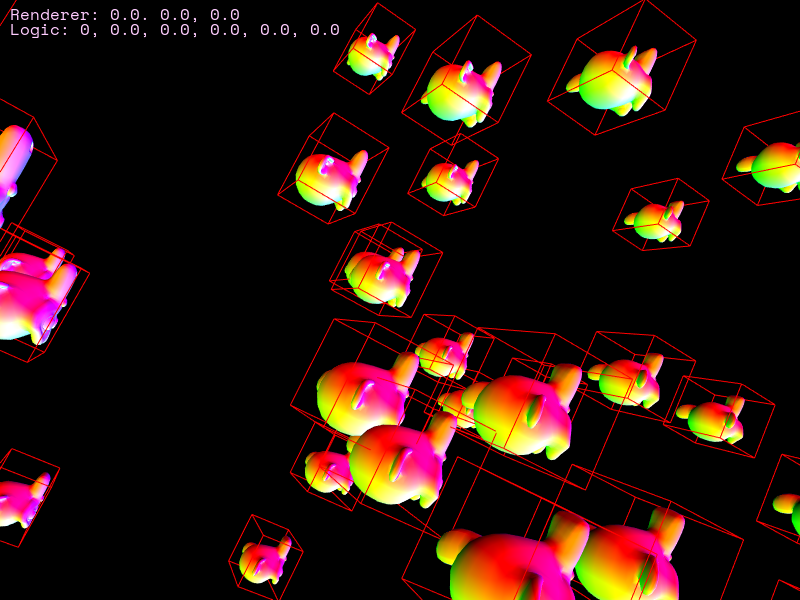

# YAGE

Yet Another Game Engine is a C++17 playground for OpenGL rendering. The demo loads glTF meshes, draws their bounding boxes, and overlays renderer and logic statistics. `yagecore` contains the engine, `yagepack` loads asset bundles, and `app` contains the demo.

## Demo

These screenshots show the Suzanne demo at commit `0a0a3a7` on Linux/X11. The current `develop` source contains an in-progress asset-loading refactor with compile errors.

| Scene overview | Camera moved and meshes rotated |
| --- | --- |
|  |  |

Use **WASD** to move, **Space/Left Shift** to move vertically, and drag with the left mouse button to look around. The arrow keys rotate the meshes.

## Build the demo revision on Linux

Install Git, CMake, a C++17 compiler, Python 3, and development headers for X11, OpenGL, GLM, FreeType, libpng, and zlib.

```sh
git worktree add --detach ../yage-demo 0a0a3a7
cd ../yage-demo
sed -i 's|<../../include/yagecore/log.hpp>|<yagecore/log.hpp>|' yagecore/src/app/statistics.cpp
sed -i 's|"libpng/png.h"|<png.h>|' yagecore/src/graphics/texture.cpp
cmake --preset release
cmake --build build/release --parallel
python3 -m venv venv
venv/bin/pip install -r yagepack/tools/pack/requirements.txt
venv/bin/python yagepack/tools/pack/pack.py --dir app/assets --output app/assets/assets.pack
cd build/release/out
./app
```

If a dependency checkout fails with `unable to read tree`, fetch the pinned `REPO_COMMIT` into the corresponding `thirdparty` clone, check out `FETCH_HEAD`, and rerun CMake. The pins for [fastgltf](yagecore/cmake/thirdparty/fastgltf.cmake) and [jsoncpp](yagepack/cmake/jsoncpp.cmake) are in their CMake files.
